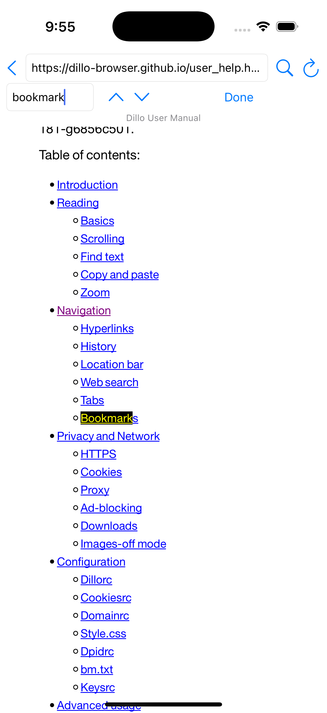
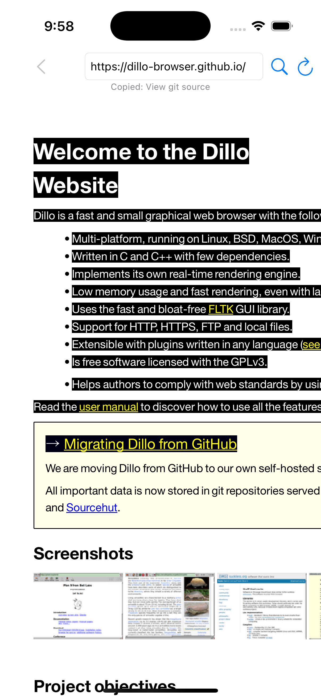
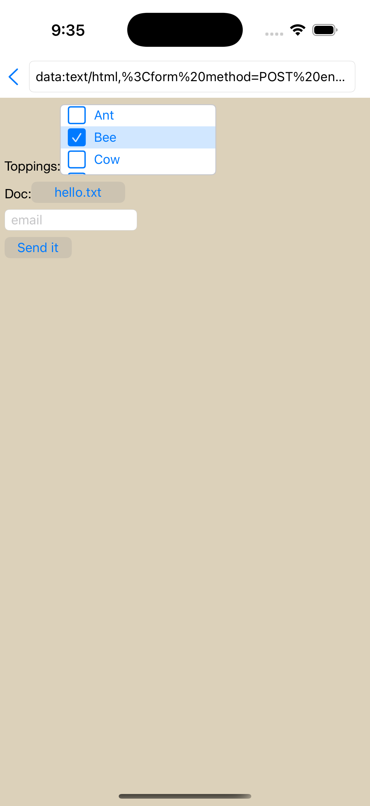
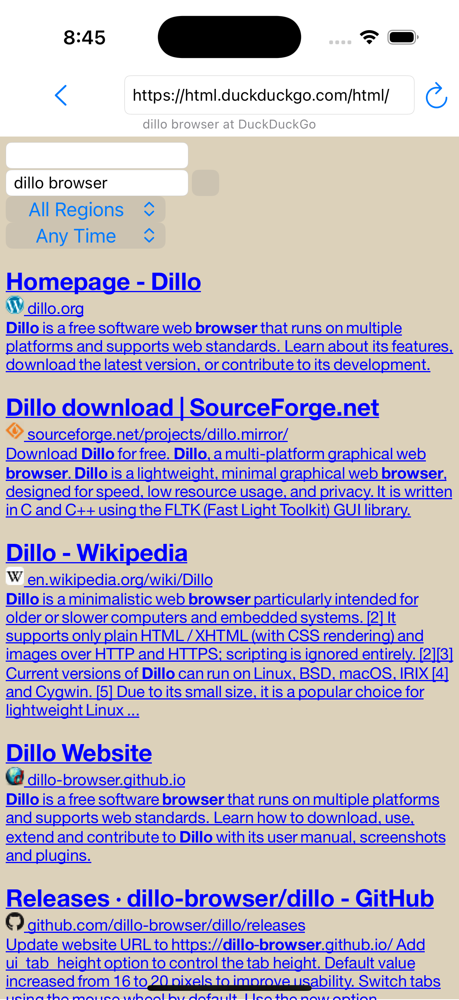
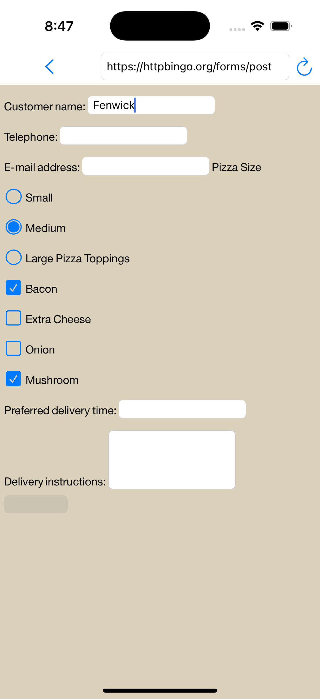
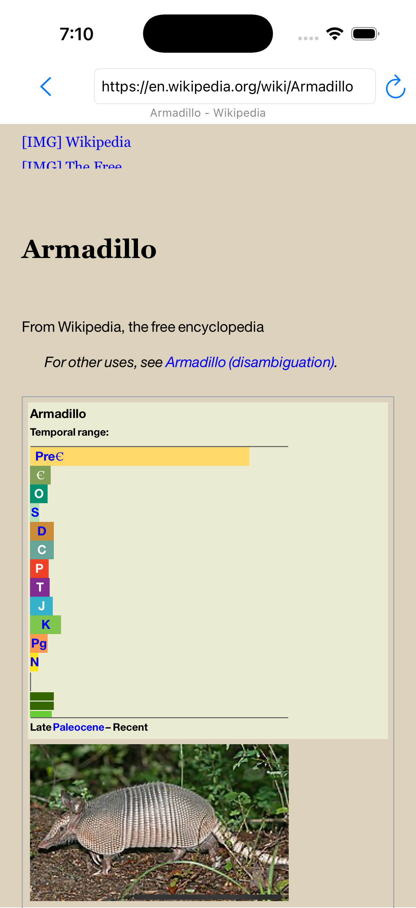
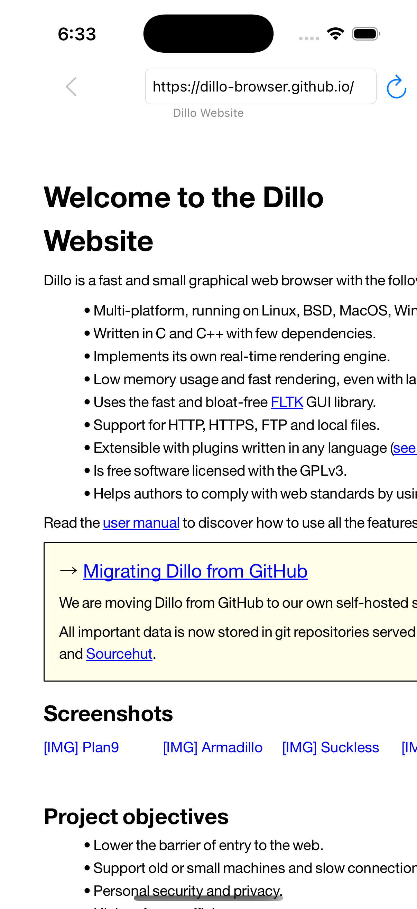
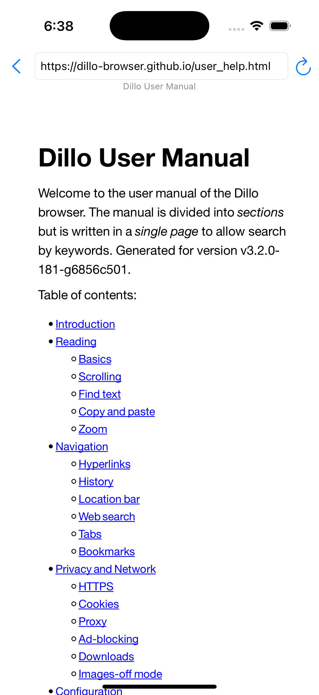
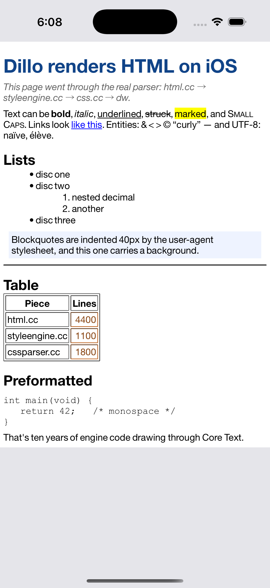
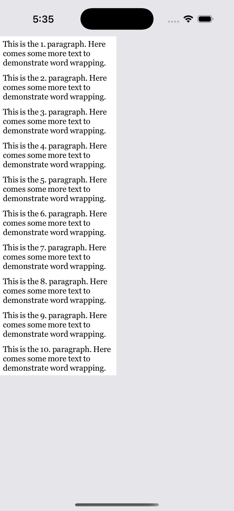

# Dillo iOS — Results

**Status: it's a browser you can actually use.** Milestone 1: the `dw/`
engine renders styled, word-wrapped text on iOS through Core Text / Core
Graphics with zero FLTK linked in. Milestone 2: the **real HTML parser and
CSS engine** run on iOS against a hardcoded document. Milestone 3: **Dillo
browses the live web** — address bar, HTTPS, external stylesheets, tappable
links, history. Milestone 4: **images** — async loading, ImageIO decode,
the engine's own scaling. Milestone 5: **interactive forms** — native
UIKit controls driven by the engine's layout, GET and POST submission
through dillo's own `form.cc`.

## Milestone 6 — navigation polish (the M8 list)

 

The unlock for this whole milestone: `CoreGraphicsView::usesViewport()`
now returns **true**, which switches on the engine's entire scrolling
machinery (`Layout::scrollTo0` is gated on it) — while the actual moving
is still done by the shell's `UIScrollView`, driven through a new
`scrollTo` hook, with user scrolling reported back via
`Layout::scrollPosChanged` so scroll-into-view math stays correct.
Everything below fell out of that plus thin UI:

- **Anchor navigation**: tapping a `#fragment` link into the current
  document scrolls (engine anchor table → animated content offset)
  instead of reloading; `a_Url_cmp` (which ignores fragments) decides
  "same document". Cross-page deep links (`page.html#section`) anchor
  after load via `setAnchor`. Verified on the user manual's ToC — and the
  anchored link turned purple, because the history/visited-color module
  has been along for the ride the whole time.
- **Find-in-page**: a find bar (magnifier in the chrome) drives
  `Layout::search`/`resetSearch` — `dw/findtext.cc` was compiled since
  milestone 2 and just needed a UI. Matches get the engine's yellow-on-
  black highlight and scroll into view; wrapped/not-found status shown.
- **Selection + copy**: long-press-drag forwards
  press/motion/release with `BUTTON1_MASK` into the engine's selection
  state machine (`dw/selection.cc`, also compiled all along); on release
  the selection lands on `UIPasteboard` via a new copy hook, with a
  "Copied: …" toast. Scrolling is disabled during the gesture — the pan
  recognizer wins otherwise.
- **Chrome**: left-edge swipe navigates back; error pages got styling
  and a "Try again" link.

Not done from the M8 list: per-page load progress, history persistence.

## Milestone 5.5 — form completeness (the M6.5 list)



All four gaps from the forms milestone closed, verified live:

- **`<button>` labels**: the child HTML's text is extracted with the same
  deep widget-tree traversal selection uses (`DeepIterator`, lazily at
  first post-parse `sizeRequest`), the native button is retitled and
  resized, and `queueResize(true)` reflows the page around it. httpbingo's
  submit now reads "Submit order". (Fun fact: `UIButtonConfiguration`
  ignores `titleLabel.font`; the 14 pt font must ride in an attributed
  title or buttons render ~20 pt and overflow their engine-computed
  frames.)
- **File upload works end to end**: File selector → `UIDocumentPicker`
  (asCopy) → picked file read by `form.cc`'s own `readFile` → multipart
  POST to httpbingo echoing the boundary and body. Design note: UIKit
  will not complete a presentation while a touch event is held up, so the
  desktop's blocking-modal model (nested run loop) is impossible — the
  picker runs async in two phases: the first click presents and returns
  NULL; picking stores the path and re-fires the same button's click,
  whose `a_UIcmd_select_file` call then consumes the stored path inside
  dillo's unmodified flow. Button labels show the basename (sandbox
  paths are comically long). The app's Documents folder is exposed to
  Files (`UIFileSharingEnabled`) so the picker has somewhere local.
- **Inline multi-select lists**: `<select multiple/size=N>` renders as a
  bordered, scrollable list of checkable rows (toggling verified);
  dropdowns keep the popup menu.
- **Autofill hints**: password fields get `.password`; placeholder
  heuristics map email/username/phone to `textContentType` and keyboard
  types.

Also new: `data:` URLs load (handy for testing forms without a server).

## Milestone 5 — interactive forms

 

Verified end-to-end on live sites:

- **Search works.** `html.duckduckgo.com/html`: typing "dillo browser"
  into the native `UITextField` and pressing return fires
  `emitActivate` → `form.cc` (single-entry form) → GET query URL →
  navigation. Results render with the query preserved in the results
  page's own field and the region/time `<select>`s as native popup
  buttons.
- **POST works.** `httpbingo.org/forms/post`: name typed into a text
  field, "Medium" picked by radio (exclusivity enforced through the
  shared group), Bacon and Mushroom checked, submit tapped. The JSON echo
  shows `"method": "POST"`, `application/x-www-form-urlencoded`, and
  `custname=Fenwick&...` — the body built by dillo's own
  `DilloHtmlForm::buildQueryData` reading values out of UIKit controls.

How it's put together:

- **`Dillo/NativeFormResources.mm`** — the iOS counterpart of
  `dw/fltkui.cc`. Each `dw::core::ui::Resource` owns a real UIControl
  (`UITextField`, `UITextView`, SF-Symbol check/radio buttons with shared
  radio groups, `UIButton` label buttons, `UIButton`+`UIMenu` selects)
  added as a subview of the browser's scroll view — whose content
  coordinates are canvas coordinates, so controls track the page during
  scrolling with zero extra work. Geometry flows engine→UIKit via
  `sizeRequest`/`sizeAllocate`; interaction flows back through the
  engine's own `emitClicked`/`emitActivate` (which is what `form.cc`
  subscribes to). Controls are hidden until first allocation.
  `ApplePlatform::setResourceFactory` swaps this factory in; the
  display-only `StubResources` remain the fallback.
- **POST plumbing**: `a_UIcmd_open_url` receives a `DilloUrl` with
  `URL_Post` + body `Dstr` (and `URL_MultipartEnc`, whose boundary is
  recovered from the body's first line, as the desktop `http.c` does).
  The bridge surfaces `(url, body, contentType)` to the shell;
  `PageLoader` issues the request; history entries carry method+body so
  back/reload re-issue correctly.
- **Chrome**: the link-tap recognizer now takes only touches that land
  on the bare scroll view (a gesture delegate), so controls get their
  touches; keyboard overlap adjusts the scroll inset; `text/plain` /
  JSON / XML responses render escaped inside `<pre>` (that's how the
  POST echo is readable).

Gaps: `<button>` labels aren't rendered (ComplexButton child HTML is not
painted — shows as a blank native button); file uploads are display-only;
`ListResource` multi-select uses a popup menu rather than an inline list;
no autofill/password-manager integration.

ObjC++ gotcha worth remembering: blocks are not lambdas — they get no
access to the enclosing member function's protected members, hence the
public `fire*`/`toggle`/`pick` trampolines on the resource classes.

## Milestone 4 — images (and surviving forms)



Verified on live sites: the Dillo homepage renders its PNG screenshot
thumbnails; Wikipedia's Armadillo article renders **styled** (serif display
title, bordered taxobox, the geological time-range chips — all real CSS
through the cascade) with the nine-banded armadillo JPEG decoded and drawn
in place. SVG images degrade to alt text (ImageIO has no SVG decoder).

What was built:

- **`AppleImgbuf`** (`ios/engine/AppleImgbuf.{hh,cc}`): a port of
  `dw/fltkimgbuf.cc` — root + scaled buffers, gamma-aware averaging
  scaler, reference counting — with `draw()` wrapping the raw RGB rows in
  a CGImage (local y-flip, nearest-neighbor since rows are pre-scaled).
  `ApplePlatform::createImgbuf` and `CoreGraphicsView::drawImage` now do
  real work; `src/imgbuf.cc` joins the compile set.
- **Async image pipeline**: `a_Capi_open_url` recognizes image webs and
  hands them (with a client key for bw's progress bookkeeping) to the
  shell via a new `ImageFetchHook`. The bridge fetches with URLSession;
  on completion `dw::ios::deliverImageData` decodes via ImageIO,
  composites alpha over the image's `bg_color`, and drives the DilloImage
  state machine exactly as the desktop dicache does (`a_Imgbuf_new` →
  `set_parms` → per-row `a_Imgbuf_update` + `a_Image_write` → `close`).
  Pages render first; images pop in as they arrive — real browser
  behavior. Pending fetches are cancelled on navigation (web validity
  guarded the same way capi's ValidWebs list works).
- **`StubResources`** (`ios/engine/StubResources.{hh,cc}`): display-only
  form widgets. The milestone-2 assumption that the resource factory was
  "unreached" died on contact with Wikipedia's search `<input>` (NULL
  deref in `Embed`); every resource type now returns a real, fixed-size,
  draw-nothing object. The complex-button resource attaches a contextless
  `CoreGraphicsView` to its inner layout — `Layout::queueResize`
  dereferences the view, so "no view" is not an option.
- **Entity decoding in the CSS prefetcher**: Wikipedia's stylesheet URLs
  contain `&amp;`; the parser entity-decodes hrefs before resolving, so
  the prefetch cache keys have to match that form or every lookup misses
  (which is why Wikipedia first rendered unstyled).

Known image gaps: srcset/lazy-loaded images whose real URL never appears
in `src` don't load; no SVG; no progressive/partial rendering (each image
appears complete when its fetch finishes); no image cache across pages.

## Milestone 3 — a real browser

 

Verified in the simulator against live sites: `dillo-browser.github.io`
loads over HTTPS with its real stylesheet applied (the yellow notice box,
link styling); tapping "user manual" hit-tests through the engine
(`Layout::buttonPress/Release` → `HtmlLinkReceiver::click` →
`a_UIcmd_open_url` → shell hook) and navigates to `user_help.html` with
title and history updated; the back button returns; typing `example.com`
in the address bar normalizes, loads, and renders. Images are off
(`prefs.load_images = FALSE`) pending an Imgbuf implementation, so `[IMG]`
alt placeholders appear — authentically Dillo.

### Architecture (what replaced what)

| Desktop                                   | iOS                                                                                                                                                                                                                                                                                                        |
| ----------------------------------------- | ---------------------------------------------------------------------------------------------------------------------------------------------------------------------------------------------------------------------------------------------------------------------------------------------------------- |
| `src/IO/` sockets + TLS + `select()` loop | `URLSession` (`PageLoader.swift`)                                                                                                                                                                                                                                                                          |
| `cache.c`/`capi.c` streaming cache        | prefetch + mini-cache (`IosCapi.cc`): the shell fetches the page **and its stylesheets** (link scan + recursive `@import`, resolved via dillo's own `url.c` so cache keys match the parser) _before_ parsing, then the parser's cached-CSS fast path in `a_Html_load_stylesheet` serves them synchronously |
| `uicmd.cc` (FLTK UI commands)             | hook registry (`IosShell.hh`): `a_UIcmd_open_url` / `set_page_title` dispatch to Swift blocks                                                                                                                                                                                                              |
| `nav.c` history (cache-coupled)           | app-side URL list in `BrowserViewController`                                                                                                                                                                                                                                                               |
| FLTK viewport scrolling                   | `UIScrollView` physics + visible-rect expose: the render view stays screen-sized and `drawIntoContext:visibleRect:` translates the CTM by the scroll offset, so tall pages cost no backing store                                                                                                           |
| FLTK mouse events                         | `UITapGestureRecognizer` → `Layout::buttonPress/buttonRelease` with `BUTTON1_MASK` — the engine's real link hit-testing and click signal                                                                                                                                                                   |

Charset handling: HTTP header → `<meta>` sniff → UTF-8 → Latin-1, decoded
in Swift; the parser is always fed UTF-8 (content type says so).

One layout per app lifetime, one `DilloHtml` per page —
`Layout::setWidget` frees the old page (and its retained parse buffer is
freed only after the swap, per the milestone-2 lesson).

### Known gaps (next milestones)

- **Images**: needs an `Imgbuf` implementation (decode via CGImage) plus
  image fetches in the prefetch pass or an async repaint path.
- Pages wider than the viewport wrap at their min-width and pan
  horizontally (correct engine behavior; a zoom gesture would help).
- No cookies, form submission, find-in-page, tabs, or fragment scrolling.
- Stylesheet fetches the regex scan misses (e.g. JS-injected) are simply
  absent — same as desktop Dillo with CSS off for those sheets.

---

# Milestone 2 — real HTML/CSS parser (hardcoded page)



The bridge no longer hand-builds a Textblock; it heap-copies a hardcoded
HTML document and feeds it to `DilloHtml::write()`. Everything visible went
through the genuine parser stack and cascade (user-agent stylesheet +
`<style>` block + inline classes): styled `h1`, class selectors, b/i/u/s,
`<mark>` backgrounds, **small-caps**, link styling, character entities and
UTF-8, nested ul/ol with bullets and numbering, an indented blockquote with
background, `<hr>`, a bordered table with `th` styling and per-cell
alignment/color, and monospace `<pre>`.

What it took (all in `ios/`, no engine or parser source changed):

- **Compile set** (`project.yml`): `html.cc css.cc cssparser.cc
styleengine.cc table.cc form.cc image.cc bw.c misc.c colors.c url.c
prefs.c klist.c bitvec.c history.c` — all compiled unmodified.
- **`engine/utf8_ios.cc`** replaces `src/utf8.cc` (which wraps FLTK's
  `fl_utf8*`): a faithful port of `fl_utf8decode` including its CP1252
  fallback for illegal bytes, which the tag-soup parser depends on.
- **`engine/BrowserStubs.cc`** satisfies the 26 link-time symbols from the
  browser shell: `a_Capi_*` (report "not cached / can't fetch"),
  `a_UIcmd_*` (no-op), `a_Web_new/free` (data half of web.cc),
  `a_Dialog_choice`, `a_Hsts_require_https`.
- **`config.h`**: `#define inbuf_t char` (the configure-time iconv probe);
  the app links `libiconv.tbd` for form.cc.
- **Bridge init** mirrors `dillo.cc`'s order (`a_Prefs_init`, `a_Web_init`,
  `a_Bw_init`, `StyleEngine::init`) and `web.cc`'s RootUrl dispatch block
  (canvas bg color, initial "body" style, `layout->setWidget`). Font prefs
  are swapped to iOS families (Georgia / Helvetica Neue / Courier New).

**The one crash along the way is the most useful lesson for the next
milestone:** `Html_write_raw` tokenizes its input buffer **in place** and
`DilloHtml` retains the pointer (`Start_Buf`) after parsing. Feeding it a
string literal SIGBUSes; the buffer must be writable heap memory that
outlives the parser — the desktop cache layer guarantees exactly this, so
whatever replaces it on iOS must too.

---

# Milestone 1 — engine + Core Text (original spike)



Screenshot: iPhone 16 Pro simulator (iOS 18.4). The dw_example test page — ten
numbered paragraphs, Georgia 14, 5 px margins — laid out by `dw::Textblock`
into a 200 pt column. Every paragraph wraps across three lines ("… paragraph.
Here / comes some more text to / demonstrate word wrapping."), breaks are
identical across all ten paragraphs, no overlap, no clipped descenders.
Consistent breaks at the same words are only possible when
`Platform::textWidth` (measurement) and `View::drawText` (paint) agree — which
was the question the spike existed to answer.

## Building / running

```sh
cd ios
xcodegen generate          # produces DilloSpike.xcodeproj from project.yml
xcodebuild -project DilloSpike.xcodeproj -scheme Dillo \
  -destination 'platform=iOS Simulator,name=iPhone 16 Pro,OS=18.4' build
```

Or open the generated project in Xcode and run the `Dillo` scheme.
The `.xcodeproj` is generated — `project.yml` is the source of truth.

## What was built

| Piece             | File(s)                                    | Notes                                                                                                                                       |
| ----------------- | ------------------------------------------ | ------------------------------------------------------------------------------------------------------------------------------------------- |
| Engine static lib | `DilloEngine` target                       | all of `dw/` minus `fltk*`, `lout/`, `dlib/` — **compiled unmodified**                                                                      |
| iOS `config.h`    | `ios/engine/config.h`                      | replaces the autoconf one; engine subset only reads PACKAGE/VERSION/HAVE_STDINT_H                                                           |
| Platform          | `ios/engine/AppleCoreTextPlatform.{hh,cc}` | `ApplePlatform`, `AppleFont` (CTFontRef + metrics), `AppleColor`; mirrors `fltkplatform.cc` incl. small-caps and letter-spacing measurement |
| View              | `ios/engine/CoreGraphicsView.{hh,cc}`      | all paint primitives into a `CGContextRef`; clipping via GState save/clip/restore; `usesViewport()` = false                                 |
| App shell         | `ios/DilloSpike/`                          | `SpikeBridge.mm` is `dw_example.cc`'s main body with the four FLTK nouns swapped; Swift `UIView.drawRect` hands its context to the bridge   |

## Findings (in plan risk-log order)

1. **Metric agreement worked on the first render.** Measurement and painting
   share one code path (`AppleFont::measureWidth` on the same `CTFontRef`),
   so they cannot drift. `CTLineGetTypographicBounds` truncated to int matches
   how the engine consumed FLTK's `fl_width`.
2. **UTF-8 stepping** was ported as plain continuation-byte skipping
   (`fl_utf8fwd`/`fl_utf8back` semantics); shared between platform and view.
3. **`-fno-exceptions -fno-rtti` across the ObjC++ boundary** was a non-issue:
   the whole app (including `SpikeBridge.mm`) builds with those flags.
4. **`lout` portability**: zero changes needed for arm64/iOS SDK.
5. **Hidden FLTK reach-ins: none.** Verified two ways: grep (only doc comments
   in `imgbuf.hh`/`ui.hh` mention FLTK) and `nm` on the compiled archive
   (zero `Fl_`/`fl_` symbols).

## Things the next milestone should know

- **No event loop:** FLTK's idle queue is replaced by
  `ApplePlatform::runIdles()`, which the bridge drains synchronously after
  building the widget tree and again before each paint. `Layout::resizeIdle`
  runs there. A real browser shell will want these on the main run loop
  (`dispatch_async`) instead.
- **Wrap width** is fed via the public `Layout::viewportSizeChanged()`, which
  sets `viewportWidth` (what `Widget::getAvailWidth` reads) even though the
  view returns `usesViewport() == false`. Scrolling in the spike is a plain
  `UIScrollView` over the fully-drawn canvas.
- **dpi is pinned at 96** (`dpiX`/`dpiY`). Nothing in the spike path consults
  it (font size in `FontAttrs` is already px), but the CSS engine will —
  revisit when wiring `src/styleengine.cc`.
- **Stubbed:** images (`createImgbuf`/`drawImage` return NULL/no-op),
  tooltips, clipboard, form-widget `ResourceFactory` (returns NULL resources).
  The hyphenator compiles but finds no pattern files (`DILLO_LIBDIR` points at
  `/var/empty/`) and degrades gracefully.
- **Desktop comparison:** the desktop `dw_example` builds and runs from the
  same tree (see `test/dw/`). A side-by-side pixel capture wasn't automated
  (macOS screen-recording permission), but the iOS line breaks fall exactly
  where the column width dictates and are uniform across paragraphs, which is
  the behavior the desktop example exhibits with its (different) font.

## Verdict

~80% of the port uncertainty (font metrics + the paint seam) is retired.
Next milestone per PLAN.md: wire the real HTML/CSS parser (`src/html.cc`,
`src/css*.cc`) — engine code that talks only to the interfaces this spike
just proved out.
